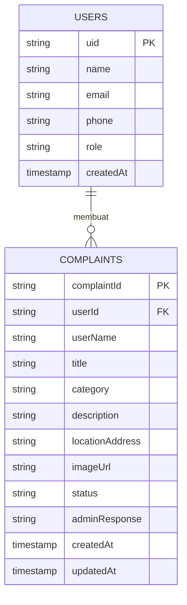
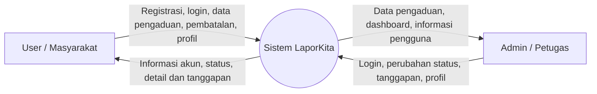
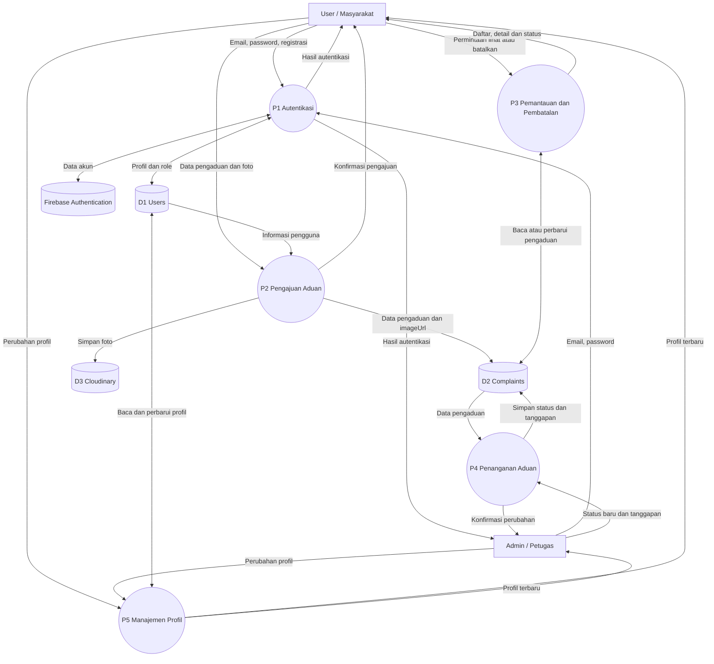

# ERD & DFD - LaporKita

Dokumentasi perancangan database dan aliran data
Sistem Informasi Manajemen Pelayanan Pengaduan Masyarakat.

---

## 1. Entity Relationship Diagram (ERD)

ERD LaporKita terdiri dari dua entitas utama,
yaitu Users dan Complaints.

### 1.1 Entitas Users

| Field | Type | Key | Description |
|---|---|---|---|
| uid | String | PK | Firebase Authentication UID |
| name | String | - | Nama pengguna |
| email | String | - | Email pengguna |
| phone | String | - | Nomor telepon |
| role | String | - | user atau admin |
| createdAt | Timestamp | - | Waktu akun dibuat |

### 1.2 Entitas Complaints

| Field | Type | Key | Description |
|---|---|---|---|
| complaintId | String | PK | ID pengaduan |
| userId | String | FK | Mengacu ke users.uid |
| userName | String | - | Nama pembuat pengaduan |
| title | String | - | Judul pengaduan |
| category | String | - | Kategori pengaduan |
| description | String | - | Deskripsi pengaduan |
| locationAddress | String | - | Alamat atau patokan |
| imageUrl | String | - | URL foto pengaduan |
| status | String | - | Status pengaduan |
| adminResponse | String | - | Tanggapan admin |
| createdAt | Timestamp | - | Waktu dibuat |
| updatedAt | Timestamp | - | Waktu diperbarui |

### 1.3 Relasi ERD

---

## 2. Data Flow Diagram (DFD)

### 2.1 DFD Level 0 (Diagram Konteks)

### 2.2 DFD Level 1

---

## 3. Data Store

| Kode | Data Store | Keterangan |
|---|---|---|
| D1 | Users | Data akun pengguna dan admin |
| D2 | Complaints | Data pengaduan |
| D3 | Cloudinary | Penyimpanan foto pengaduan |
| FA | Firebase Authentication | Autentikasi akun |

## 4. Relasi dan Aturan Data

- Satu User dapat membuat banyak pengaduan.
- Setiap pengaduan dimiliki oleh satu User.
- User hanya dapat melihat pengaduan miliknya.
- Admin dapat melihat seluruh pengaduan.
- User hanya dapat membatalkan pengaduan berstatus Menunggu.
- Admin dapat mengubah status dan memberikan tanggapan resmi.
